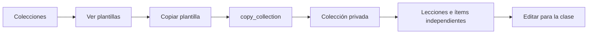
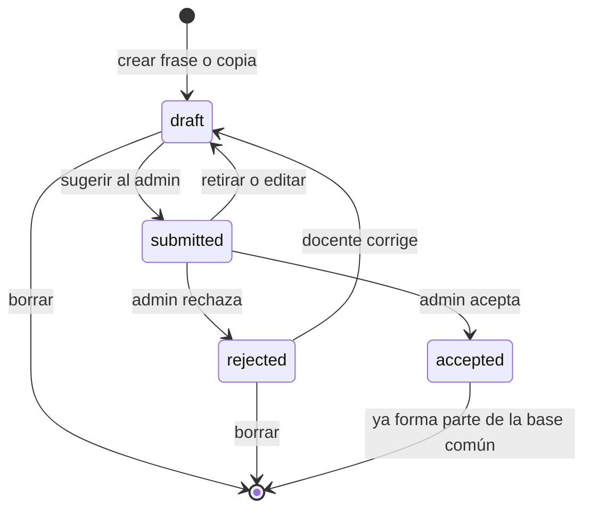
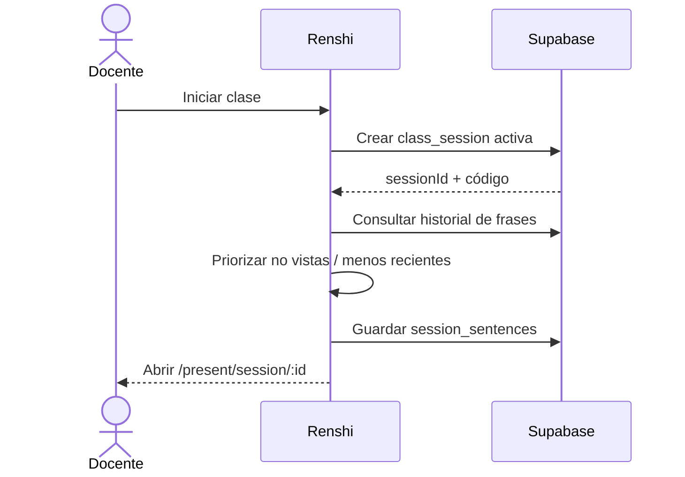
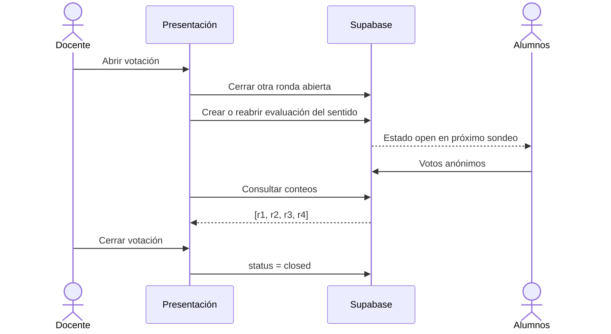
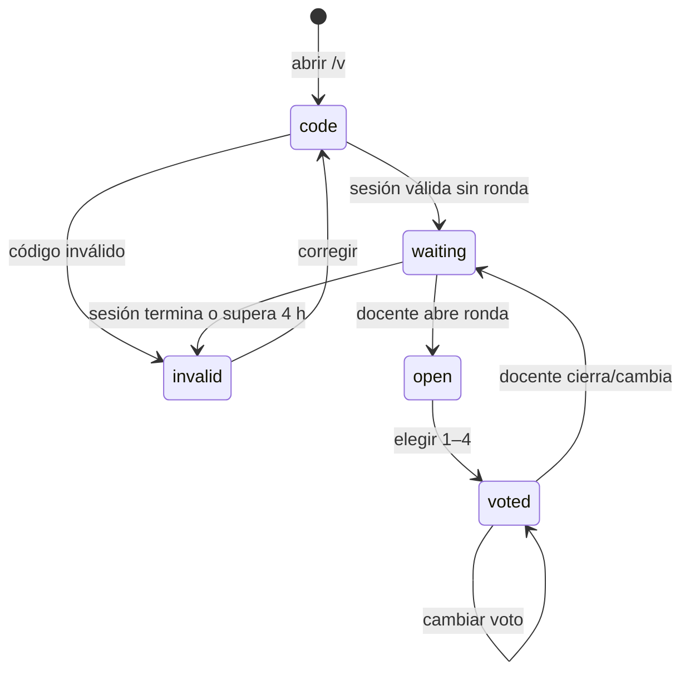
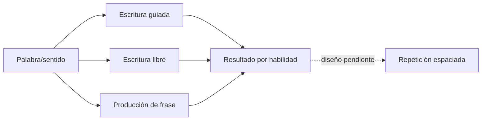

# Flujos de aplicación — Renshi

> Estado: flujos existentes en producción al 2026-10-15, con huecos pendientes señalados explícitamente.
> Convención: **D** = docente, **A** = alumno anónimo, **Admin** = administrador.

## 1. Mapa de rutas

Todas las rutas pasan por el enrutamiento de `next-intl`; inglés no necesita prefijo y chino/español usan `/zh` y `/es`. Las superficies docente y pública se traducen; el área administrativa se mantiene en español por decisión de alcance.

| Ruta lógica | Persona | Propósito |
|---|---|---|
| `/` | Pública / autenticada | Entrada y redirección según contexto. |
| `/login` | D / Admin | Iniciar sesión. |
| `/collections` | D | Ver colecciones propias y plantillas disponibles. |
| `/collections/:collectionId` | D | Gestionar lecciones de una colección. |
| `/collections/:collectionId/:lessonId` | D | Editar palabras, sentidos, orden y ejemplos de una lección. |
| `/collections/:collectionId/:lessonId/:senseId` | D | Gestionar ejemplos de un sentido. |
| `/present` | Pública | Lección de demostración local. |
| `/present/session/:sessionId` | D | Conducir una clase autenticada. |
| `/v` | A | Introducir código de clase. |
| `/v/:code` | A | Esperar, ver la palabra activa y votar. |
| `/admin` | Admin | Buscar y filtrar la biblioteca común. |
| `/admin/words/:hanzi` | Admin | Editar palabra, sentidos y frases. |
| `/admin/words/:hanzi/preview` | Admin | Previsualizar todos los sentidos como tarjetas. |
| `/admin/templates` | Admin | Gestionar plantillas globales. |
| `/admin/templates/:collectionId` | Admin | Gestionar lecciones de una plantilla. |
| `/admin/templates/:collectionId/:lessonId` | Admin | Gestionar ítems de una lección de plantilla. |
| `/admin/suggestions` | Admin | Revisar propuestas enviadas por docentes. |

## 2. Entrada y resolución de rol

```mermaid
flowchart TD
    E[Entrada] --> S{¿Sesión válida?}
    S -- No --> L[/login]
    S -- Sí --> P{Rol del perfil}
    P -- admin --> AD[/admin]
    P -- teacher o reviewer --> C[/collections]
    C --> RLS[Supabase RLS limita los datos]
    AD --> RLS
```

1. La aplicación obtiene las claims de Supabase Auth.
2. Carga el perfil correspondiente.
3. Sin perfil válido, redirige al login.
4. Un `admin` entra al catálogo administrativo; una docente entra a sus colecciones.
5. Las comprobaciones de ruta mejoran la experiencia, pero RLS sigue siendo la autoridad de datos.

Casos de fallo:

- Sesión expirada: volver al login.
- Perfil ausente tras crear usuario: el trigger debe crearlo; si no, la ruta se comporta como no autorizada.
- Docente intentando abrir `/admin`: redirección a `/collections`.

## 3. Primera preparación de la docente

### 3.1 Copiar una plantilla



1. D abre `/collections`.
2. Si no tiene colecciones, ve un estado vacío con una invitación a crear o copiar.
3. Elige una plantilla HSK o temática.
4. Confirma la copia.
5. `copy_collection` crea una colección con `owner_id = auth.uid()`, duplica lecciones e ítems y registra `copied_from`.
6. D puede renombrar, reordenar o borrar la copia sin afectar la plantilla.

Resultado esperado: una colección privada y editable con el mismo orden didáctico de la plantilla.

### 3.2 Crear desde cero

1. D crea una colección con título.
2. Entra a la colección y crea una lección.
3. Abre la lección vacía.
4. Busca palabras o pega una lista.
5. Revisa coincidencias y selecciona sentidos.
6. Añade los sentidos elegidos y ajusta el orden.

Hueco conocido: el patrón actual de creación mediante campo visible puede confundirse con un buscador; está pendiente convertirlo en una acción «Nueva colección/lección» con formulario explícito.

## 4. Edición de una lección

### 4.1 Buscar y añadir vocabulario

1. D escribe hanzi, pinyin con o sin tonos, o significado.
2. La acción de búsqueda consulta `search_words`; no descarga el catálogo completo.
3. La UI muestra la palabra con nivel, estado de contenido y sentidos disponibles.
4. D elige el sentido que quiere enseñar.
5. Puede seleccionar varias entradas y añadirlas en una operación.
6. Los nuevos ítems se colocan al final y no se duplica un sentido ya presente.

Al pegar una lista:

- las coincidencias se ofrecen para selección;
- una forma con varios sentidos exige elegir el uso;
- las formas ausentes se señalan, pero no crean una palabra global;
- pedir una palabra al administrador es un flujo pendiente.

### 4.2 Cambiar sentido, orden o cantidad de ejemplos

1. D puede sustituir el `sense_id` de un ítem por otro sentido de la misma palabra.
2. Puede mover el ítem una posición arriba o abajo.
3. Puede quitarlo de la lección sin borrar la palabra de la biblioteca.
4. Elige cuántas frases por palabra mostrará la colección (`0` = todas).
5. Opcionalmente, la lección sobrescribe ese valor; `null` vuelve a heredar.

### 4.3 Gestionar ejemplos



Opciones de D:

- crear una frase privada desde cero;
- crear una copia editada de una frase global;
- ocultar o volver a mostrar una frase global;
- enviar una frase con pinyin como sugerencia;
- retirar una sugerencia pendiente;
- corregir una frase rechazada y reenviarla.

Reglas de composición de la clase:

- una copia editada ocupa el lugar de su original;
- una frase privada nueva aparece después de las globales;
- una original oculta no aparece para esa docente;
- una sugerencia aceptada se convierte en frase global y no se duplica como privada.

## 5. Inicio de clase y rotación



1. D pulsa «Iniciar/Presentar clase».
2. La aplicación crea una sesión con código de seis caracteres sin `0/O/1/I/L`.
3. Para cada sentido obtiene frases globales, propias y copias válidas.
4. Consulta el historial dentro de la colección.
5. Selecciona primero las frases nunca vistas y después las menos recientes.
6. Guarda la selección y el orden en `session_sentences`.
7. Redirige a la presentación.

Degradación controlada: si la rotación falla, la clase abre con todas las frases disponibles; una falla secundaria no debe impedir enseñar.

## 6. Presentación de una palabra

### 6.1 Anverso

1. Se muestra el hanzi grande sobre retícula de caligrafía.
2. Los trazos se animan si existen datos locales.
3. La docente puede pausar, repetir o avanzar según los controles disponibles.
4. El pinyin puede permanecer oculto hasta que la docente lo revele.
5. Espacio o el control visible gira la tarjeta.

Si faltan trazos, el hanzi sigue visible como texto. La ausencia de enriquecimiento nunca elimina la palabra.

### 6.2 Reverso

1. Se muestra el sentido elegido: pinyin, categoría y significado.
2. «Cómo se forma» aparece solo con descomposición completa y componentes fiables.
3. Las frases muestran la palabra clave en rojo suave.
4. Pinyin y traducciones se controlan globalmente; con traducciones ocultas, una frase puede revelarse de forma individual.
5. Audio usa síntesis de voz del navegador.
6. Matiz y nota cultural aparecen como profundidad opcional.
7. Si no hay frases, aparece «Inventen una frase con X».

### 6.3 Valoración de la docente

1. D elige 1–4 para el sentido actual.
2. La acción hace `upsert` sobre `(session_id, sense_id)`.
3. Volver a elegir cambia la valoración; quitarla borra la fila.
4. Un error de red muestra feedback y no finge haber guardado.

### 6.4 Navegación

- anterior/siguiente cambia de ítem;
- anverso/reverso conserva el contexto de la palabra;
- al finalizar, D termina la sesión;
- terminar marca `ended_at` y vuelve a la entrada docente.

## 7. Flujo de votación en vivo

### 7.1 Lado de la docente



1. D muestra la URL corta y el código.
2. Abre la votación de la palabra actual.
3. Cualquier evaluación abierta de esa sesión se cierra primero.
4. Si ya hubo una ronda para ese sentido, se reabre la última y conserva votos.
5. La presentación consulta conteos y muestra distribución/participación.
6. D cierra la ronda o cambia de palabra.

Estado pendiente: si el sondeo de resultados pierde red, la UI puede congelar el último conteo sin explicar la desconexión.

### 7.2 Lado del alumno



1. A abre `/v`, introduce el código y pasa a `/v/:code`.
2. El panda guía la entrada, valida las seis casillas y comunica error o éxito.
3. `student_vote_state` devuelve:
   - `invalid`: código inexistente, sesión cerrada o con más de cuatro horas;
   - `waiting`: sesión válida sin evaluación abierta;
   - `open`: evaluación, hanzi y pinyin actuales.
4. A elige una valoración.
5. El servidor crea, si hace falta, una cookie aleatoria `httpOnly` y manda solo su hash a la función pública.
6. `cast_student_vote` inserta o actualiza el voto de ese navegador.
7. El sondeo detecta cambios de palabra sin recargar.

Fallo pendiente: después de varios errores consecutivos debe aparecer «Sin conexión, reintentando…» con `role="status"`; hoy el primer estado puede quedarse en «…».

## 8. Curación administrativa

### 8.1 Editar una palabra

1. Admin abre `/admin` y busca o filtra por nivel/estado.
2. Abre una palabra.
3. Edita nota cultural, estado, sentidos y frases; puede añadir, quitar y reordenar.
4. Previsualiza una tarjeta por sentido.
5. Guarda la palabra completa mediante `save_word`.
6. Publicar cambia el estado y marca como revisados los hijos que seguían `unreviewed`.

Casos de fallo:

- borrar un sentido utilizado por una lección o valoración devuelve «en uso»;
- pinyin o texto vacío se valida antes de aceptar una sugerencia;
- salir con cambios sin guardar todavía no activa aviso del navegador;
- algunos borrados siguen usando confirmación nativa y deben migrar al diálogo común.

### 8.2 Resolver sugerencias

1. Admin abre `/admin/suggestions`.
2. Revisa frase, traducciones, pinyin, autora y frase de origen.
3. Si acepta:
   - puede añadirla como frase nueva; o
   - reemplazar la original si nació como copia.
4. Un reemplazo guarda el texto anterior en `revisions`.
5. Si rechaza, escribe una nota opcional.
6. La docente conserva la frase privada, puede corregirla y volver a enviarla.

### 8.3 Gestionar plantillas

El flujo reproduce el editor de colecciones y lecciones, pero con `owner_id = null`, `teacher_id = null` y autorización exclusiva de administrador.

## 9. Estados transversales obligatorios

Cada pantalla debe distinguir, como mínimo:

- cargando;
- vacío con siguiente acción clara;
- éxito guardado;
- error validable por el usuario;
- error de red recuperable;
- no autorizado o sesión expirada;
- dato ausente legítimo;
- operación bloqueada porque el dato está en uso.

No se debe:

- mostrar una lista vacía sin explicación;
- convertir un error de red en espera infinita;
- ocultar una palabra porque carece de frases o descomposición;
- afirmar que algo se guardó antes de recibir confirmación;
- revelar significado o datos privados desde las funciones públicas de voto.

## 10. Flujo futuro de autoestudio

Es una exploración separada, no una extensión automática de la clase en vivo.



Antes de implementarlo hay que definir identidad del alumno, criterios de corrección, alternativas válidas, ayudas, separación por habilidad y política de datos. No debe reutilizar sin diseño la votación anónima, porque esta mide una señal grupal y no un progreso individual.
