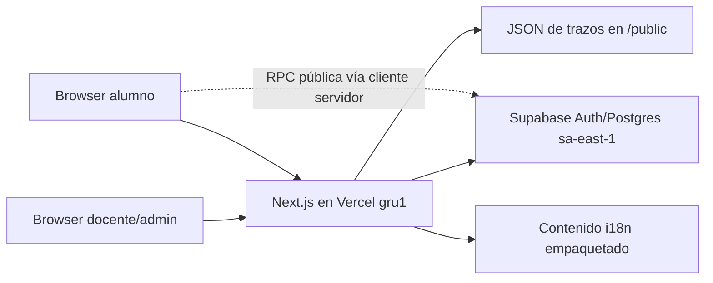

# Requisitos técnicos — Renshi

> Estado: arquitectura implementada y restricciones vigentes al 2026-10-15.
> Este documento define qué debe preservar una implementación; el esquema detallado está en [05-backend-schema.md](05-backend-schema.md).

## 1. Objetivos técnicos

- Servir una clase en vivo con latencia baja desde Sudamérica.
- Mantener contenido compartido, datos privados de docente y voto anónimo en límites de seguridad distintos.
- Permitir curación incremental sin que una importación pise trabajo humano.
- Funcionar en escritorio para la docente y en móvil para el alumno sin instalación.
- Probar migraciones y recorridos contra una base separada antes de producción.
- Mantener el sistema pequeño: una aplicación Next.js y un backend Supabase, sin servicios innecesarios.

## 2. Stack obligatorio

| Capa | Tecnología vigente | Requisito |
|---|---|---|
| Runtime | Node.js ≥ 20.9 | Desarrollo, CI y Vercel deben respetar la versión mínima. |
| Aplicación | Next.js 16.4, App Router, Cache Components | `cacheComponents` y `partialPrefetching` permanecen habilitados salvo decisión documentada. |
| UI | React 19.3, TypeScript estricto | No introducir JavaScript sin tipado para lógica de producto. |
| Estilos | Tailwind CSS 4 + shadcn/ui sobre Base UI | Los colores pedagógicos se consumen como tokens, no valores ad hoc. |
| Idiomas | `next-intl` 4.14 | Rutas y mensajes en `zh`, `es`, `en`; fallback inglés. |
| Tema | `next-themes` | Claro y oscuro conservan la semántica de tokens. |
| Datos/Auth | Supabase Auth + PostgreSQL + RLS | La autorización de datos vive también en la base. |
| Chino | Hanzi Writer + datos autoalojados | Ninguna dependencia de una API de trazos durante la clase. |
| Hosting | Vercel, región `gru1` | Mantener app cerca de Supabase `sa-east-1`. |
| Pruebas | Node test + PGlite + Playwright | Unitarias, permisos, visuales y recorridos con sesión real. |

Antes de escribir código de Next.js se debe leer la guía relevante de la versión instalada en `node_modules/next/dist/docs/`; no se asumen APIs de versiones anteriores.

## 3. Topología

Decisiones:

- No hay backend adicional ni API de IA en producción.
- Vercel usa únicamente URL y clave publicable de Supabase.
- La clave secreta/service role no se almacena en Vercel.
- Los alumnos acceden a dos funciones `security definer` muy limitadas; no reciben acceso de tabla.
- El audio de la demo usa Web Speech API y se considera una mejora progresiva.

## 4. Estructura de aplicación

### 4.1 Componentes de servidor y acceso a datos

- Las lecturas privadas se ejecutan en Server Components o módulos `server-only`.
- `createClient()` crea un cliente Supabase por petición y llama `connection()` antes de APIs dependientes de tiempo/cookies para evitar prerender inseguro con Cache Components.
- Nunca se comparte un cliente autenticado entre peticiones.
- Las cookies de sesión se refrescan en `src/proxy.ts` después de que `next-intl` haya preparado la respuesta.
- No debe insertarse lógica entre la creación del cliente SSR del proxy y `auth.getClaims()`.

### 4.2 Server Actions

- Las mutaciones de docente/admin se implementan como Server Actions.
- Cada acción valida sesión y, cuando corresponda, rol antes de invocar Supabase.
- RLS o una función SQL vuelve a validar la autorización; la comprobación en TypeScript no es suficiente.
- Las acciones de formularios devuelven resultados discriminados (`ok` / código de error) para feedback localizado.
- Después de una mutación que afecta la vista actual se usa la invalidación compatible con Next.js 16; hoy el proyecto usa `refresh()`.
- No se devuelven mensajes internos de base directamente al alumno anónimo.

### 4.3 Límites de cliente

El código cliente se reserva para:

- interacción de tarjeta y animación;
- estado visual de formularios;
- sondeo de votación/resultados;
- síntesis de voz del navegador;
- controles que necesitan eventos de teclado o puntero.

Los catálogos completos, autorización y composición de contenido permanecen en servidor.

## 5. Autenticación y autorización

### 5.1 Personas autenticadas

- Supabase Auth gestiona identidad.
- Un trigger crea `profiles` al dar de alta un usuario.
- Roles permitidos: `teacher`, `reviewer`, `admin`.
- El usuario solo puede actualizar `display_name` y `reviews_languages` de su perfil.
- Una docente lee la biblioteca compartida, sus colecciones, sesiones y ejemplos.
- Solo `admin` modifica o borra la biblioteca común y las plantillas.
- El rol `reviewer` no debe recibir permisos implícitos nuevos hasta definir su flujo.

### 5.2 Alumnos anónimos

- No crean usuario ni sesión de Supabase Auth.
- Solo `student_vote_state(text)` y `cast_student_vote(...)` tienen `execute` para `anon`.
- Ambas funciones fijan `search_path = ''`, califican objetos con `public.` y validan sesión/evaluación internamente.
- Las sesiones de más de cuatro horas o terminadas son inválidas.
- La identidad efímera es un token aleatorio de 256 bits en cookie `httpOnly`, `sameSite=lax`, `secure` en producción y duración de seis horas.
- La base almacena SHA-256 del token, no el token ni datos personales.

### 5.3 Secretos

- Nunca commitear `.env*`, sesiones de prueba, respaldos ni `input-externo/`.
- `.env.example` solo contiene placeholders.
- Las contraseñas las escribe una persona en el navegador; scripts y agentes no las solicitan ni registran.
- GitHub Actions de keep-alive usa únicamente claves publicables.

## 6. Datos y consistencia

### 6.1 Identidad de contenido

- `words` identifica una grafía simplificada; `senses` representa lectura/uso/categoría; `lesson_items` referencia el sentido.
- Las importaciones idempotentes preservan UUID existentes.
- No deduplicar por hanzi cuando el temario distingue entradas por pronunciación o categoría.
- HSK se modela de forma versionada en `word_levels`; `words.hsk_level` y `hsk_version` son compatibilidad temporal.
- La banda HSK 7–9 es conjunta en la fuente, aunque el esquema legado acepte enteros 1–9. No repartirla artificialmente.

### 6.2 Gobierno editorial

- Cada entidad editable mantiene `origin`, `status`, revisor y fecha cuando el modelo lo permite.
- Estados: `unreviewed`, `reviewed`, `corrected`.
- Lo humano revisado prevalece sobre imports y generación.
- Una sincronización solo inserta faltantes o actualiza borradores explícitamente autorizados.
- Las correcciones que reemplazan contenido global dejan historial en `revisions`.
- La procedencia de frases por fuente/id sigue siendo una deuda que debe resolverse antes de publicar una exportación atribuida.

### 6.3 Transacciones e invariantes

- Operaciones multi-entidad críticas viven en PostgreSQL (`copy_collection`, `save_word`, `accept_teacher_example`).
- Solo existe un código activo igual y una evaluación abierta por sesión.
- Orden de lecciones e ítems es único dentro de su padre.
- Reordenar usa una posición temporal para no chocar con índices únicos.
- Una sesión fija sus frases en `session_sentences`; recargar no debe reseleccionarlas.
- Volver a votar desde el mismo navegador actualiza la fila existente.

## 7. Búsqueda

- La búsqueda se ejecuta en PostgreSQL mediante `search_words`.
- Acepta hanzi, pinyin con o sin tonos y significado español/inglés.
- `plain_pinyin` normaliza tonos, espacios, mayúsculas y `ü → v`.
- Devuelve página limitada, total y facetas de nivel/estado.
- El límite se acota en la función (máximo actual: 500).
- Con el catálogo HSK 4–9 no se permite volver a filtrar todas las filas en el navegador.

## 8. Tiempo real y sondeo

La votación usa sondeo; Realtime no es requisito actual.

- El alumno consulta estado aproximadamente cada pocos segundos.
- La docente consulta resultados mientras una ronda está abierta.
- La UI debe distinguir espera de pérdida de red y aplicar reintento con backoff razonable.
- Las peticiones solapadas se evitan o cancelan al desmontar.
- Cambiar de pestaña no debe producir múltiples intervalos.
- Realtime solo se evaluará si una clase real demuestra latencia problemática.
- Antes de escalar públicamente se debe evaluar rate limiting para las funciones de voto.

## 9. Rendimiento

Requisitos:

- Región Vercel `gru1`; cambiarla requiere medición comparativa.
- La primera vista de docente no descarga el catálogo completo.
- Trazos se sirven como archivos estáticos locales y solo se cargan para caracteres necesarios.
- Consultas de una lección agrupan palabras, sentidos y frases en servidor.
- Los índices soportan códigos activos, evaluación abierta, búsqueda por pinyin, orden de catálogo e historial de rotación.
- Las animaciones no bloquean navegación ni dependen de terminar para revelar contenido.
- La votación móvil debe seguir útil en una conexión lenta; el HTML inicial no depende de imágenes pesadas.

Objetivo operativo para la demo: las acciones normales deben percibirse inmediatas en la región objetivo y una falla secundaria (audio, rotación, animación) no debe bloquear la clase.

## 10. Internacionalización

- Locales de las superficies docente y pública: `zh`, `es`, `en`; el área administrativa se mantiene en español.
- Fallback: inglés cuando el navegador no coincide.
- Selector recordado y separado del idioma pedagógico.
- Las claves de mensajes deben ser idénticas entre los tres JSON.
- Admin debe centralizar su copy español en el sistema de mensajes/componentes; no se permiten cadenas dispersas ni confirmaciones nativas cuyo idioma controle el navegador.
- Contenido chino usa `lang="zh-Hans"`; pinyin, `lang="zh-Latn"`.
- Fechas, números y textos de estado pasan por funciones/locales, no concatenaciones rígidas.

## 11. Accesibilidad técnica

- HTML semántico antes que ARIA.
- Foco visible global y retorno de foco tras cerrar overlays.
- Controles táctiles ≥ 44 px en móvil.
- Escala 1–4 modelada como radiogroup o equivalente semántico.
- Mensajes asíncronos anunciados sin robar foco.
- `prefers-reduced-motion` elimina el dibujo progresivo y presenta el carácter completo.
- Contraste automatizado para tokens y casos reales.
- Pruebas manuales pendientes con lector de pantalla y zoom 200/400 %.

## 12. Manejo de errores

- Separar errores de autenticación, entrada inválida, dato en uso y fallo inesperado.
- Ningún `catch` de red crítico puede quedar silencioso.
- Una espera inicial tiene timeout visual o transición a «reintentando».
- Una mutación optimista debe revertirse o mostrar claramente que no se guardó.
- La presentación tolera falta de audio, trazos, descomposición o frases.
- Logs no incluyen cookies, tokens, contraseñas, claves ni contenido personal.

## 13. Entornos y despliegue

### Local

- `npm ci`
- `.env.local` con producción/entorno ordinario según la máquina.
- `npm run dev`, puerto 3000 por defecto.

### Desarrollo de base

- Proyecto Supabase separado `hanzi-dev` mediante `.env.dev.local`.
- `npm run dev:base-dev`, puerto 3001.
- Sesiones Playwright separadas en `tests/.auth-dev`.
- Toda migración se prueba aquí con respaldo previo.

### Producción

- `master` despliega a Vercel.
- `renshi.davila.uno` es el dominio canónico.
- `hanzi.davila.uno` redirige permanentemente preservando ruta.
- Otras ramas generan preview.
- Despliegue y dominios se gestionan por CLI.
- Push o despliegue a `master` requiere pedido o confirmación explícita.

## 14. Migraciones y contenido

- Migraciones SQL son ordenadas, inmutables una vez aplicadas y viven en `supabase/migrations`.
- No editar una migración ya aplicada para corregir producción; crear otra.
- Antes de producción: respaldo, aplicación en `hanzi-dev`, pruebas de permisos y recorridos.
- Después: verificar conteos e invariantes, no solo que el comando terminó.
- Imports de contenido tienen validador e idempotencia.
- Nunca ejecutar una carga masiva contra producción sin respaldo fechado.

## 15. Estrategia de pruebas

| Nivel | Comando | Cobertura mínima |
|---|---|---|
| Unidad | `npm run test:unit` | Rotación, semáforo, categorías y lógica pura. |
| Base/RLS | `npm run test:db` | Esquema, políticas, funciones y permisos con PGlite. |
| Contenido | `npm run validate:content`, `npm run validate:hsk` | Forma, referencias, niveles y catálogo. |
| Visual | `npm run test:visual` | 390×844, 1366×768, 1440×900 y 1920×1080; claro/oscuro. |
| Recorridos | `npm run test:recorridos:dev` | Docente, admin y alumno anónimo contra `hanzi-dev`. |
| Producción | verificación puntual no destructiva | Dominio, login, lectura y RPC pública. |

Los recorridos que escriben usan marcas «Prueba automática» / «自动测试» y limpian sus datos.

## 16. Observabilidad y operación

Estado actual: logs de Vercel/Supabase y verificaciones manuales; no hay plataforma de telemetría de producto.

Requisitos mínimos antes de una demo real:

- errores de Server Actions con contexto de operación, nunca secretos;
- error visible al usuario cuando una acción crítica falla;
- comprobación del keep-alive de producción y desarrollo;
- consulta de sesiones activas atascadas y posibilidad de cerrarlas;
- registro de fecha, commit y entorno para cada prueba relevante.

Agregar analítica o monitoreo externo requiere decisión de privacidad; no se incorpora por defecto.

## 17. Compatibilidad y deuda conocida

- `words.hsk_level`/`hsk_version` duplican información de `word_levels`.
- El estado de revisión es por entidad, no todavía por campo e idioma.
- `reviewer` existe, pero la edición global efectiva exige `admin`.
- Procedencia de frase no está normalizada por cada `sentence`.
- El sondeo expone desconexión tras dos fallos consecutivos y se recupera automáticamente; falta validarlo con redes móviles reales.
- Web Speech API varía entre navegador y sistema operativo.
- No existe límite de peticiones específico por IP para la votación.
- HSK 4–9 está integrado en `master` y producción; su contenido sigue siendo borrador editorial salvo lo revisado explícitamente.

## 18. Definición técnica de terminado

Un cambio está terminado cuando:

1. respeta límites de rol y RLS;
2. tiene migración idempotente/segura si cambia datos;
3. funciona en los tamaños y temas pertinentes;
4. expone carga, vacío y error recuperable;
5. pasa las pruebas proporcionales al riesgo;
6. se valida primero en `hanzi-dev` si toca base;
7. actualiza documentación/bitácora si cambia arquitectura o estado;
8. no incluye secretos, sesiones, respaldos ni artefactos externos.
