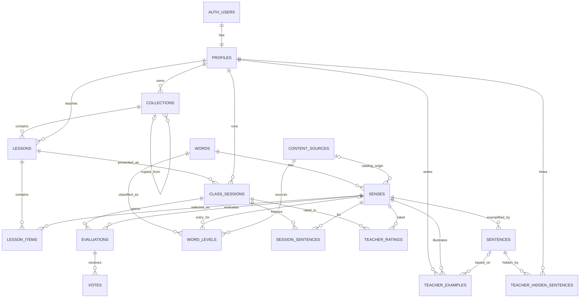

# Esquema backend — Renshi

> Estado: modelo efectivo de las migraciones en `supabase/migrations` al 2026-10-15.
> Motor: PostgreSQL administrado por Supabase, con Auth y RLS.
> Este documento describe el esquema; las migraciones SQL siguen siendo la fuente ejecutable.

## 1. Dominios del modelo

El backend separa cinco dominios:

1. **Identidad:** usuarios autenticados y roles.
2. **Biblioteca compartida:** palabras, sentidos, frases, caracteres, niveles y fuentes.
3. **Trabajo privado de docente:** colecciones, lecciones, ejemplos propios y frases ocultas.
4. **Clase en vivo:** sesiones, selección de frases, valoración docente y rondas.
5. **Participación anónima:** votos agregables sin perfil de alumno.

`characters` se relaciona lógicamente con cada carácter de `words.hanzi`, pero no existe una clave foránea porque la palabra contiene una cadena de uno o más caracteres.

## 2. Tipos enumerados

| Tipo | Valores | Uso |
|---|---|---|
| `content_origin` | `open_data`, `ai`, `person` | Procedencia resumida de contenido. |
| `review_status` | `unreviewed`, `reviewed`, `corrected` | Estado editorial. |
| `session_status` | `active`, `ended` | Ciclo de clase. |
| `evaluation_status` | `open`, `closed` | Ciclo de ronda de votación. |
| `content_source_kind` | `official_standard`, `official_exam`, `academic_corpus`, `open_dictionary`, `open_data`, `person` | Tipo de fuente trazable. |
| `teacher_example_status` | `draft`, `submitted`, `accepted`, `rejected` | Ciclo de propuesta docente. |

El rol de perfil es `text` con `check`: `teacher`, `reviewer`, `admin`.

## 3. Identidad

### 3.1 `profiles`

Extiende `auth.users` uno a uno.

| Columna | Tipo | Restricciones / significado |
|---|---|---|
| `id` | `uuid` | PK y FK a `auth.users`, cascade delete. |
| `display_name` | `text` | Obligatorio. |
| `role` | `text` | `teacher` por defecto; check de roles. |
| `reviews_languages` | `text[]` | Idiomas que la persona puede revisar. |
| `created_at` | `timestamptz` | `now()`. |

`handle_new_user()` crea el perfil tras el alta y también se usó para completar usuarios existentes.

Seguridad:

- cada persona lee su perfil;
- solo actualiza `display_name` y `reviews_languages` propios;
- no puede elevar su rol;
- admin puede leer perfiles para identificar autoría de sugerencias.

## 4. Biblioteca compartida

### 4.1 `characters`

| Columna | Tipo | Significado |
|---|---|---|
| `char` | `text` | PK; exactamente un carácter. |
| `pinyin` | `text[]` | Lecturas conocidas. |
| `radical` | `text` nullable | Radical principal. |
| `decomposition` | `text` nullable | Fórmula de componentes. |
| `components` | `jsonb` | Lista `{ char, role, ... }`. |
| `etymology` | `jsonb` nullable | Tipo y pistas semántica/fonética. |
| `stroke_roles` | `text[]` | Papel por trazo: semantic/phonetic/other. |
| `origin` | `content_origin` | `open_data` por defecto. |

Lectura para autenticados; escritura de curación solo admin.

### 4.2 `words`

| Columna | Tipo | Significado |
|---|---|---|
| `id` | `uuid` | PK generada. |
| `hanzi` | `text` | Único; forma usada por la app. |
| `hsk_level` | `smallint` nullable | Compatibilidad temporal, 1–9. |
| `hsk_version` | `text` | Compatibilidad temporal; default `2.0`. |
| `cultural_note_es` / `cultural_note_en` | `text` nullable | Nota cultural por palabra. |
| `origin` | `content_origin` | Default `ai`. |
| `status` | `review_status` | Default `unreviewed`. |
| `reviewed_by` | `uuid` nullable | FK a perfil. |
| `reviewed_at` | `timestamptz` nullable | Fecha de revisión. |
| `created_at` | `timestamptz` | `now()`. |

La clasificación nueva no debe depender de `hsk_level/hsk_version`; vive en `word_levels`.

### 4.3 `senses`

| Columna | Tipo | Significado |
|---|---|---|
| `id` | `uuid` | PK. |
| `word_id` | `uuid` | FK a `words`, cascade delete. |
| `position` | `smallint` | Orden sugerido; único dentro de palabra. |
| `pinyin` | `text` | Lectura con tonos. |
| `pinyin_plain` | `text` nullable | Forma normalizada para búsqueda. |
| `category` | `text` nullable | Categoría gramatical. |
| `meaning_es` / `meaning_en` | `text` nullable | Glosas. |
| `nuance_es` / `nuance_en` | `text` nullable | Contraste o nota de uso. |
| `catalog_source_id` | `text` nullable | FK a `content_sources`. |
| `catalog_source_order` | `integer` nullable | Posición de entrada oficial. |
| `origin` | `content_origin` | Default `ai`. |
| `status` | `review_status` | Default `unreviewed`. |
| `reviewed_by` / `reviewed_at` | FK / fecha nullable | Revisión. |

Índices:

- `pinyin_plain`;
- único parcial `(catalog_source_id, catalog_source_order)` cuando ambos existen.

### 4.4 `sentences`

| Columna | Tipo | Significado |
|---|---|---|
| `id` | `uuid` | PK. |
| `sense_id` | `uuid` | FK a `senses`, cascade delete. |
| `position` | `smallint` | Orden; único dentro de sentido. |
| `zh` | `text` | Frase china. |
| `pinyin` | `text` | Pinyin de la frase. |
| `translation_es` / `translation_en` | `text` nullable | Traducciones. |
| `computed_level` | `smallint` nullable | Nivel máximo calculado. |
| `origin` | `content_origin` | Default `ai`. |
| `status` | `review_status` | Default `unreviewed`. |
| `reviewed_by` / `reviewed_at` | FK / fecha nullable | Revisión. |

Deuda: no existe todavía FK directa a `content_sources` ni identificador de frase externa.

### 4.5 `content_sources`

Registro de procedencia reutilizable.

| Columna | Tipo | Significado |
|---|---|---|
| `id` | `text` | PK slug. |
| `name`, `publisher` | `text` | Identidad de fuente. |
| `kind` | `content_source_kind` | Clasificación. |
| `source_url` | `text` | URL de referencia. |
| `version_label` | `text` nullable | Edición/versión. |
| `license_name`, `license_url` | `text` nullable | Licencia. |
| `redistribution_allowed` | `boolean` | Default `false`. |
| `retrieved_at` | `date` | Fecha de consulta. |
| `notes` | `text` nullable | Condiciones/uso. |
| `created_at` | `timestamptz` | `now()`. |

Lectura autenticada; gestión admin.

### 4.6 `word_levels`

Clasificación versionada por entrada y, si se conoce, por sentido.

| Columna | Tipo | Significado |
|---|---|---|
| `id` | `bigint identity` | PK. |
| `word_id` | `uuid` | FK a palabra, cascade delete. |
| `sense_id` | `uuid` nullable | FK a sentido, set null. |
| `standard` | `text` | `hsk-2.0` o `hsk-3.0`. |
| `level` | `smallint` | 1–9. |
| `source_id` | `text` | FK a `content_sources`. |
| `source_order` | `integer` nullable | Orden oficial positivo. |
| `source_label` | `text` nullable | Etiqueta original. |
| `source_level_label` | `text` nullable | Conserva rótulos como `7-9`. |
| `pinyin` | `text` nullable | Lectura de la entrada. |
| `part_of_speech` | `text` nullable | Categoría de fuente. |
| `created_at` | `timestamptz` | `now()`. |

Invariantes:

- `(standard, source_order)` es único;
- índice `(word_id, standard, level)`;
- la banda 7–9 se conserva en `source_level_label`; no se infiere una separación pedagógica inexistente.

### 4.7 `revisions`

Historial de correcciones globales.

| Columna | Tipo | Significado |
|---|---|---|
| `id` | `bigint identity` | PK. |
| `entity` | `text` | Tabla lógica (`words`, `senses`, `sentences`). |
| `entity_id` | `uuid` | Identificador no enlazado por FK polimórfica. |
| `field` | `text` | Campo cambiado. |
| `old_value`, `new_value` | `text` nullable | Antes/después. |
| `author` | `uuid` nullable | FK a perfil. |
| `created_at` | `timestamptz` | `now()`. |

Solo admin registra cambios; autenticados pueden leer según las políticas actuales.

## 5. Contenido privado de docente

### 5.1 `teacher_examples`

| Columna | Tipo | Significado |
|---|---|---|
| `id` | `uuid` | PK. |
| `teacher_id` | `uuid` | Propietaria; cascade delete. |
| `sense_id` | `uuid` | Sentido ilustrado; cascade delete. |
| `zh`, `pinyin` | `text` / nullable | Frase y pinyin. |
| `translation_es`, `translation_en` | `text` nullable | Traducciones. |
| `note` | `text` nullable | Nota privada/editorial. |
| `status` | `teacher_example_status` | Default `draft`. |
| `based_on_sentence_id` | `uuid` nullable | Original copiada; set null. |
| `promoted_sentence_id` | `uuid` nullable | Frase global resultante; set null. |
| `review_note` | `text` nullable | Respuesta del admin. |
| `reviewed_by`, `reviewed_at` | FK / fecha nullable | Decisión admin. |
| `created_at`, `updated_at` | `timestamptz` | Tiempos. |

Índices:

- `(teacher_id, status)`;
- parcial por `status = 'submitted'`.

Reglas:

- la docente crea borradores propios;
- puede editar/eliminar mientras no estén `accepted`;
- editar devuelve a `draft`;
- admin ve y decide las `submitted`;
- una aceptada apunta a una frase global.

### 5.2 `teacher_hidden_sentences`

| Columna | Tipo | Significado |
|---|---|---|
| `teacher_id` | `uuid` | FK a perfil, default `auth.uid()`. |
| `sentence_id` | `uuid` | FK a frase global. |

PK compuesta `(teacher_id, sentence_id)`. Solo la propietaria gestiona sus filas.

## 6. Colecciones y lecciones

### 6.1 `collections`

| Columna | Tipo | Significado |
|---|---|---|
| `id` | `uuid` | PK. |
| `owner_id` | `uuid` nullable | Docente; `null` = plantilla global. |
| `title` | `text` | 1–120 caracteres. |
| `description` | `text` nullable | Descripción. |
| `source_note` | `text` nullable | Origen de la lista. |
| `copied_from` | `uuid` nullable | Auto-FK a plantilla/colección, set null. |
| `examples_shown` | `smallint` | Default 2; 0–9, donde 0 = todas. |
| `created_at` | `timestamptz` | `now()`. |

Índice por `owner_id`.

### 6.2 `lessons`

| Columna | Tipo | Significado |
|---|---|---|
| `id` | `uuid` | PK. |
| `teacher_id` | `uuid` nullable | Propietaria; null en plantillas. |
| `collection_id` | `uuid` nullable | FK a colección, cascade delete. |
| `title` | `text` | Título. |
| `position` | `smallint` nullable | Orden dentro de colección. |
| `examples_shown` | `smallint` nullable | 0–9; null hereda colección. |
| `created_at` | `timestamptz` | `now()`. |

Reglas:

- `teacher_id` o `collection_id` debe existir;
- `(collection_id, position)` es único cuando hay colección;
- una plantilla tiene lecciones sin docente y dentro de colección global.

### 6.3 `lesson_items`

| Columna | Tipo | Significado |
|---|---|---|
| `lesson_id` | `uuid` | FK a lección, cascade delete. |
| `sense_id` | `uuid` | FK a sentido. |
| `position` | `smallint` | Orden didáctico. |

PK `(lesson_id, sense_id)` y unique `(lesson_id, position)`.

## 7. Clase en vivo

### 7.1 `class_sessions`

| Columna | Tipo | Significado |
|---|---|---|
| `id` | `uuid` | PK. |
| `lesson_id` | `uuid` | Lección presentada. |
| `teacher_id` | `uuid` | Docente propietaria. |
| `join_code` | `text` | Seis caracteres `[A-HJ-KM-NP-Z2-9]`. |
| `status` | `session_status` | `active` por defecto. |
| `expected_students` | `smallint` nullable | Mayor que cero. |
| `started_at` | `timestamptz` | `now()`. |
| `ended_at` | `timestamptz` nullable | Cierre. |

Índice único parcial sobre `join_code` para sesiones activas.

### 7.2 `session_sentences`

Congela la rotación al iniciar la clase.

| Columna | Tipo | Significado |
|---|---|---|
| `session_id` | `uuid` | FK a sesión, cascade delete. |
| `sense_id` | `uuid` | FK a sentido, cascade delete. |
| `sentence_key` | `text` | `s:<uuid>` global o `t:<uuid>` docente. |
| `position` | `smallint` | Orden en esa sesión. |
| `shown_at` | `timestamptz` | `now()`. |

PK `(session_id, sense_id, sentence_key)` e índice `(sense_id, sentence_key)`. La clave no es FK deliberadamente: borrar una frase no rompe el historial.

### 7.3 `teacher_ratings`

| Columna | Tipo | Significado |
|---|---|---|
| `session_id` | `uuid` | Sesión. |
| `sense_id` | `uuid` | Sentido. |
| `rating` | `smallint` | 1–4. |
| `updated_at` | `timestamptz` | `now()`. |

PK `(session_id, sense_id)`; se actualiza por `upsert`.

### 7.4 `evaluations`

| Columna | Tipo | Significado |
|---|---|---|
| `id` | `uuid` | PK. |
| `session_id` | `uuid` | Sesión. |
| `sense_id` | `uuid` | Sentido. |
| `status` | `evaluation_status` | `open` por defecto. |
| `opened_at` | `timestamptz` | `now()`. |
| `closed_at` | `timestamptz` nullable | Cierre. |

Índice único parcial: una sola evaluación `open` por sesión.

### 7.5 `votes`

| Columna | Tipo | Significado |
|---|---|---|
| `evaluation_id` | `uuid` | FK a evaluación, cascade delete. |
| `voter_hash` | `text` | SHA-256 hex del token efímero. |
| `rating` | `smallint` | 1–4. |
| `created_at`, `updated_at` | `timestamptz` | Tiempos. |

PK `(evaluation_id, voter_hash)`: el alumno cambia su voto sin duplicarlo.

## 8. Vistas y funciones

### 8.1 Vista `session_results`

Vista `security_invoker` que reúne por sesión/sentido:

- valoración docente;
- total de votos;
- conteos 1, 2, 3 y 4;
- lección, fecha y alumnos esperados.

Si hubo varias rondas del mismo sentido, agrega sus votos.

### 8.2 Funciones de aplicación autenticada

| Función | Seguridad | Propósito |
|---|---|---|
| `is_admin()` | `security definer` | Consulta segura del rol actual. |
| `copy_collection(template_id)` | `security definer` | Copia colección, lecciones e ítems para la docente. |
| `save_word(p jsonb)` | `security invoker` | Guarda/reordena palabra completa; exige admin. |
| `set_word_status(word, new_status)` | `security invoker` | Publica o devuelve a borrador y propaga revisión. |
| `accept_teacher_example(example_id, replace_original)` | `security invoker` | Promueve sugerencia; opcionalmente reemplaza y registra revisión. |
| `sentence_history(lesson, senses[])` | `security invoker` | Última vez que la clase vio cada frase. |
| `plain_pinyin(text)` | `immutable` | Normaliza pinyin para búsqueda. |
| `search_words(q, levels, statuses, lim)` | `security invoker` | Búsqueda paginada con facetas. |

### 8.3 Funciones públicas de voto

| Función | Retorno | Validaciones |
|---|---|---|
| `student_vote_state(code)` | JSON `invalid`, `waiting` u `open` | Sesión activa, código normalizado, inicio < 4 h, evaluación abierta. |
| `cast_student_vote(code, evaluation, voter, rating)` | `boolean` | Rating 1–4, hash hex 64, evaluación abierta perteneciente al código y sesión válida. |

Ambas son `security definer`, `search_path = ''`, revocadas de `public` y concedidas solo a `anon`/`authenticated`. `anon` no tiene políticas de tabla.

## 9. Matriz de acceso

| Recurso | Anónimo | Docente | Admin |
|---|---|---|---|
| Biblioteca (`words`, `senses`, `sentences`, `characters`) | Sin acceso de tabla | Leer | Leer/escribir/borrar |
| Fuentes y niveles | Sin acceso | Leer | Gestionar |
| Colecciones privadas | Sin acceso | Solo propias | Solo las propias, salvo acciones de plantilla |
| Plantillas | Sin acceso | Leer/copiar | Gestionar |
| Ejemplos docentes | Sin acceso | Solo propios no aceptados | Ver/decidir enviados |
| Lecciones e ítems | Sin acceso | Propios + lectura de plantillas | Propios + plantillas |
| Sesiones/ratings/evaluaciones | RPC pública limitada | Solo propias | Solo propias salvo acceso adicional explícito |
| Votos | Escribir únicamente vía RPC | Leer los de sus sesiones | Según propiedad de sesión |
| Perfiles | Sin acceso | Propio | Propio + lectura para sugerencias |

## 10. Borrado y cascadas

- Borrar usuario elimina perfil y, por cascada, colecciones, lecciones privadas, sesiones y ejemplos.
- Borrar colección elimina sus lecciones.
- Borrar lección elimina ítems y sesiones.
- Borrar palabra elimina sentidos, frases y clasificaciones.
- Borrar sentido falla si una FK sin cascade lo usa en una lección, rating o evaluación; la UI debe informar «en uso».
- Borrar sesión elimina frases fijadas, ratings, evaluaciones y votos.
- `based_on_sentence_id` y `promoted_sentence_id` usan `set null` para conservar el ejemplo docente.

Operaciones materiales requieren respaldo y confirmación; la UI no debe asumir que una cascada es reversible.

## 11. Invariantes de negocio

1. Una lección selecciona sentidos concretos.
2. Una docente nunca modifica directamente contenido global.
3. Una plantilla no tiene propietaria.
4. La selección de frases no cambia dentro de una sesión.
5. Solo hay una votación abierta por sesión.
6. El alumno no necesita identidad persistente.
7. Un voto por navegador/evaluación se puede modificar, no multiplicar.
8. Una importación no pisa contenido humano revisado.
9. El orden oficial y la etiqueta original se conservan.
10. Datos incompletos se ocultan o degradan; no se rellenan por inferencia silenciosa.

## 12. Deuda y evolución recomendada

### Alta prioridad

- Añadir procedencia por frase (fuente, identificador externo y licencia) sin perder UUID.
- Definir revisión por idioma/campo si se necesita afirmar que chino está revisado pero español no.
- Resolver el rol `reviewer`: eliminarlo o darle permisos y flujo explícitos.

### Media prioridad

- Retirar `words.hsk_level/hsk_version` cuando todas las consultas consuman `word_levels`.
- Representar la banda HSK 7–9 sin depender de un entero ambiguo.
- Añadir solicitudes de palabras fuera del catálogo.
- Añadir palabras de apoyo por frase y su relación con niveles.

### Solo si la validación lo exige

- Rate limiting externo o tabla de cuotas para RPC anónimas.
- Realtime en lugar de sondeo.
- Identidad y progreso de alumno para autoestudio.

## 13. Reglas para cambiar el esquema

1. Crear una migración nueva; no reescribir una ya aplicada.
2. Respaldar `hanzi-dev`, aplicar y ejecutar `npm run test:db`.
3. Ejecutar los recorridos autenticados contra desarrollo.
4. Verificar conteos, constraints, índices y RLS con casos positivos y negativos.
5. Preparar rollback lógico o restauración antes de producción.
6. Respaldar producción y aplicar solo tras aprobación.
7. Registrar qué cambió, por qué, qué se probó y qué no.
