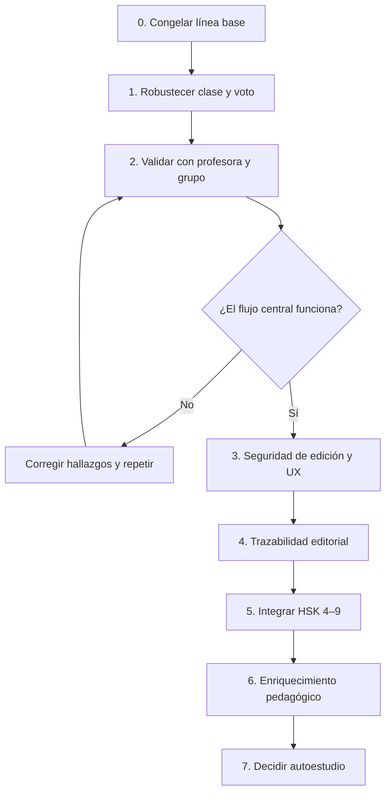

# Plan de implementación — Renshi

> Corte: 2026-10-15.
> Objetivo: llevar el producto actual desde una demo funcional a una clase real validada, antes de ampliar el alcance.
> Regla: cada migración pasa primero por `hanzi-dev` con respaldo y recorridos; producción requiere aprobación explícita.

## 1. Punto de partida

Renshi ya tiene el circuito principal completo:

`biblioteca → plantilla/colección → lección → clase → valoración/voto → curación`

No conviene reconstruirlo. El trabajo siguiente debe reducir riesgo en una clase real, validar el producto con la profesora y solo después ampliar catálogo o autoestudio.

### 1.1 Capacidades cerradas

- Login y separación de roles.
- Colecciones, lecciones, plantillas y selección por sentido.
- Búsqueda server-side del catálogo.
- Ejemplos privados, copias, ocultamiento y sugerencias.
- Rotación y fijación de frases por sesión.
- Presentación con trazos, composición, ejemplos y consigna sin frases.
- Valoración docente y votación anónima sincronizada.
- Administración de palabras, plantillas y sugerencias.
- HSK 1–3 con significado español y frases; diez colecciones temáticas con cobertura.
- Interfaz `zh/es/en`, temas claro/oscuro y recorridos Playwright.

### 1.2 Trabajo preparado pero no desplegado

- Rama `contenido-hsk4-9` con catálogo HSK 4–9, migraciones, glosas y caracteres probados en `hanzi-dev`.
- Experimento `prueba-escritura`, pendiente de prueba con dedo y de diseño pedagógico.
- Rediseño `ux-voto-alumno`, no integrado y atrasado respecto al panda actual; debe evaluarse por ideas, no fusionarse a ciegas.

### 1.3 Riesgos que bloquean declarar el MVP validado

1. El alumno puede quedar en espera muda cuando pierde red.
2. La vista docente puede congelar conteos sin indicar desconexión.
3. Falta probar la votación con una clase real y varios teléfonos.
4. La profesora real todavía no ha recorrido el producto completo.
5. Hanzi y pinyin no declaran idioma en todas las superficies para lector de pantalla.
6. El contenido sigue `unreviewed` hasta revisión humana.

## 2. Orden de ejecución

Las fases 3–6 pueden preparar tickets en paralelo, pero la integración y el despliegue siguen ese orden salvo evidencia nueva.

## 3. Fase 0 — Congelar línea base documental

**Objetivo:** que producto, diseño y backend tengan una referencia común antes de cambiar comportamiento.

Entregables:

- `01-product-requirements.md`;
- `02-app-flows.md`;
- `03-design-brief.md`;
- `04-technical-requirements.md`;
- `05-backend-schema.md`;
- este plan.

Tareas:

- revisar contradicciones frente a código y migraciones;
- enlazar estos documentos desde el índice documental cuando Ever confirme que serán canónicos;
- mantener `IDEA.md`, `ARQUITECTURA.md` y `BRIEF-DISENO.md` como historia/decisiones, sin borrarlos;
- registrar futuras variaciones de alcance en los requisitos y la bitácora.

Salida: una persona nueva puede explicar qué existe, cómo fluye, cómo se diseña y dónde vive cada dato sin leer todo el historial.

## 4. Fase 1 — Robustecer clase y votación

**Prioridad: P0.** No cambia el concepto; evita fallos silenciosos durante la clase.

### 4.1 Estado de red del alumno

Requisitos: `PR-VOTE-05`.

Implementación:

1. Contar fallos consecutivos de `studentStateAction`.
2. Mantener el último estado útil solo si se identifica como desactualizado.
3. Tras el umbral acordado, mostrar «Sin conexión, reintentando…» con `role="status"`.
4. Reintentar con intervalo acotado/backoff y restablecer el contador al recuperar red.
5. Evitar llamadas solapadas y limpiar timers al desmontar.
6. Diferenciar código inválido, espera legítima y desconexión.

Pruebas:

- primer request falla;
- falla después de votar;
- recupera red sin recargar;
- cambia de palabra después de recuperar;
- no duplica voto ni intervalos.

### 4.2 Estado de red de la docente

Implementación:

1. Detectar fallos de consulta de resultados.
2. Marcar conteos como «última actualización» o reconectando; no presentarlos como vivos.
3. Mantener disponible cerrar ronda y continuar clase.
4. Al recuperar red, refrescar conteos y anunciarlo de forma discreta.

### 4.3 Idioma del contenido y accesibilidad

Requisitos: `PR-UX-04`.

- Aplicar `lang="zh-Hans"` a hanzi y frases.
- Aplicar `lang="zh-Latn"` al pinyin.
- Revisar palabra, tarjeta, editor, vista previa y voto.
- Ejecutar pruebas automáticas de atributos y una pasada manual con lector de pantalla.
- Verificar zoom 200 % y 400 % en voto y clase.

### 4.4 Contraste y regresión

- Correr la prueba de contraste existente para `keyword-text` y controles.
- Confirmar que foco global sigue visible en componentes crudos.
- Mantener objetivos táctiles de voto ≥ 44 px y cuadrícula 2×2.

**Criterio de salida de fase:** una interrupción de red se comunica y se recupera; teclado, idioma y foco están verificados en los recorridos críticos.

## 5. Fase 2 — Validación con personas reales

**Prioridad: P0.** Esta fase decide el backlog posterior.

### 5.1 Prueba con la profesora

Preparación:

- usar una colección real, no solo la demo;
- seleccionar una lección corta con contenido ya cargado;
- preparar un guion de tareas, no una explicación de botones;
- grabar observaciones y captura/video del hito con consentimiento y datos difuminados.

Tareas para la profesora:

1. entrar y encontrar sus colecciones;
2. copiar o abrir una plantilla;
3. añadir/cambiar una palabra o sentido;
4. editar o crear una frase;
5. iniciar la clase;
6. revelar pinyin/traducción, explicar composición y avanzar;
7. abrir votación, interpretar resultados y terminar.

Observar:

- dónde duda sin ayuda;
- qué términos no entiende;
- qué información sobra al compartir pantalla;
- si la rotación de frases tiene valor real;
- si la valoración 1–4 representa la decisión docente;
- qué contenido lingüístico corrige.

### 5.2 Prueba de votación con grupo

- Probar primero con 10 dispositivos/navegadores; subir al tamaño de clase esperado.
- Incluir Wi-Fi y datos móviles si es posible.
- Medir entrada correcta, tiempo de actualización, cambios de voto, cambio de palabra y recuperación de red.
- Intentar código incorrecto, pestaña en segundo plano, bloqueo/desbloqueo y retorno.
- Verificar que votos no se mezclan entre dos sesiones simultáneas.

### 5.3 Decisiones al terminar

Clasificar cada hallazgo:

- bloqueo de clase;
- fricción frecuente;
- preferencia personal;
- problema de contenido;
- idea de alcance nuevo.

Solo las dos primeras categorías entran antes de la fase 3. Las ideas nuevas pasan por requisitos y no se implementan durante la prueba.

**Criterio de salida:** la profesora completa el recorrido central sin soporte técnico y el grupo vota con latencia/fiabilidad aceptables; las correcciones lingüísticas quedan registradas como `unreviewed` o revisadas por idioma según corresponda.

## 6. Fase 3 — Seguridad de edición y claridad de preparación

**Prioridad: P1 después de validar el núcleo.**

### 6.1 Diálogo común de confirmación

- Sustituir `window.confirm` en colecciones, lecciones, ejemplos y admin.
- Usar el componente existente `confirm-dialog` o consolidarlo como único patrón.
- Traducir texto y nombre del objeto.
- Mostrar consecuencias de cascada o «en uso» cuando corresponda.
- Trampa de foco, Escape, retorno al disparador y `role="alertdialog"`.

### 6.2 Cambios sin guardar

- Reutilizar el estado `dirty` del editor.
- Interceptar cierre/recarga con `beforeunload` solo mientras haya cambios.
- Para navegación interna, usar el mecanismo soportado por Next.js 16; consultar primero la documentación instalada.
- No bloquear después de guardado correcto.

### 6.3 Crear colección/lección

- Cambiar el campo ambiguo por botón «Nueva colección/lección».
- Abrir formulario con etiqueta, Crear y Cancelar.
- Repetir la acción en el estado vacío.
- Mantener búsqueda visualmente diferenciada.
- Probar teclado y móvil/tablet.

### 6.4 Lenguaje del dominio

- Probar con la profesora si «Sentido», «Uso» o «Significado» funciona mejor.
- Cambiar las tres traducciones y la documentación solo después de decidir.

**Criterio de salida:** no hay borrado mediante confirmación nativa, la edición avisa antes de perderse y crear objetos no parece una búsqueda.

## 7. Fase 4 — Trazabilidad editorial

**Prioridad: P1 para publicar la biblioteca con atribución correcta.**

### 7.1 Procedencia por frase

Diseño propuesto a validar:

- añadir `source_id` nullable a `sentences`;
- añadir `source_entry_id`/`source_url` cuando la fuente tenga identificador;
- guardar licencia mediante relación a `content_sources`;
- distinguir original interno de adaptación y traducción;
- migrar las frases de Gushi/Tatoeba sin cambiar UUID;
- crear una vista/página de créditos o exportación de atribuciones.

Antes de migrar:

- inventariar qué archivos conservan IDs fiables;
- decidir qué hacer con frases cuya procedencia no puede demostrarse;
- revisar compatibilidad de CC BY y CC BY-SA con la distribución prevista.

### 7.2 Revisión por idioma/campo

El estado por entidad no expresa «chino revisado, español pendiente».

Opciones a comparar:

1. tabla `content_reviews(entity, entity_id, field/language, status, reviewer, at)`;
2. columnas por idioma;
3. mantener estado agregado y documentar limitación.

Elegir la opción más pequeña que soporte el flujo real. No migrar solo por pureza del modelo.

### 7.3 Rol `reviewer`

Decidir:

- eliminarlo y usar `admin`; o
- permitir revisión limitada por idioma sin edición estructural/borrado.

Si se conserva, añadir pruebas RLS positivas y negativas específicas.

**Criterio de salida:** se puede responder quién aportó/revisó una frase, bajo qué licencia y en qué idioma, sin inferirlo por el archivo de origen.

## 8. Fase 5 — Integrar el catálogo HSK 4–9

**Prioridad: P2, después de validar la clase y la trazabilidad necesaria.**

La rama ya fue probada en desarrollo, pero no se asume que siga compatible con `master`.

### 8.1 Reconciliación

1. Comparar rama con `master` actual.
2. Separar cambios reales de modos de archivo o residuos de otras tareas.
3. Rebasar o fusionar en un worktree aislado sin arrastrar los dos commits no relacionados de mascota/credenciales.
4. Verificar que las migraciones mantienen orden y que no chocan con temas/frases añadidos después.
5. Revisar que la banda 7–9 conserve su etiqueta oficial.

### 8.2 Validación en `hanzi-dev`

1. Respaldar desarrollo.
2. Aplicar migraciones desde cero y sobre base existente.
3. Ejecutar `validate:hsk`, `test:db`, unitarias y recorridos.
4. Verificar conteos esperados: 1000 + 1600 + 1800 + 5600 entradas nuevas.
5. Verificar 3088 caracteres y ocultamiento de descomposiciones incompletas.
6. Buscar casos con hanzi repetido, lecturas múltiples y banda 7–9.
7. Confirmar rendimiento de `/admin` y editor de lección.

### 8.3 Integración y producción

1. Integrar a `master` con commits atómicos y documentación actualizada.
2. Crear respaldo de producción.
3. Aplicar migraciones/import con aprobación explícita.
4. Verificar conteos, búsqueda, lección y RPC pública.
5. Confirmar que palabras sin frases muestran la consigna y no desaparecen.

No declarar HSK 4–9 «curado»: las glosas/descomposiciones son borradores y la gran mayoría no tiene frases.

**Criterio de salida:** catálogo completo buscable y seleccionable en producción, sin degradar HSK 1–3 ni afirmar una cobertura pedagógica inexistente.

## 9. Fase 6 — Enriquecimiento pedagógico

Se prioriza con evidencia de la profesora.

### 9.1 Palabras de apoyo

- Modelar vocabulario superior necesario en una frase.
- Mostrar hanzi, pinyin, significado breve y nivel por hover, foco y toque.
- No contarla automáticamente como aprendida.
- Validar accesibilidad móvil antes de cargar miles de relaciones.

### 9.2 Solicitudes de palabras

- Docente solicita una forma fuera del catálogo desde «Pegar lista».
- Admin recibe bandeja con forma, contexto y solicitante.
- Aceptar inicia el flujo editorial; no publica contenido generado automáticamente.

### 9.3 Frase preferida

- Solo implementar si la rotación real demuestra que la docente necesita fijar una frase.
- Definir precedencia: fija + rotación de las restantes.

### 9.4 Idioma pedagógico por clase

- Separar preferencia de contenido de locale de interfaz.
- Decidir si vive en colección, lección o sesión.
- Diseñar fallback cuando falta traducción.

### 9.5 Más frases HSK 4–9

- Trabajar por necesidad de plantillas/clases, no por llenar 9900 entradas indiscriminadamente.
- Validar nivel, naturalidad, registro, traducción y fuente.
- Mantener `unreviewed` hasta revisión humana.

**Criterio de salida:** cada enriquecimiento resuelve una necesidad observada y conserva la trazabilidad editorial.

## 10. Fase 7 — Decisión sobre autoestudio

**No comenzar implementación de producto estable sin una fase de descubrimiento.**

### 10.1 Escritura

Usar la rama experimental para responder:

- ¿funciona con dedo en teléfonos reales?;
- ¿qué tolerancia evita falsos negativos?;
- ¿cómo se separan calcar y recordar?;
- ¿qué señales se guardan sin convertirlo en examen frustrante?;
- ¿el valor pedagógico justifica una cuenta de alumno?

### 10.2 Producción de frases

Prototipar evaluación de respuestas múltiples antes de elegir tecnología. Una coincidencia exacta no es aceptable; un LLM en vivo introduce coste, privacidad y falsa certeza.

### 10.3 Identidad y repetición espaciada

Solo después de validar ejercicios:

- definir cuentas/invitaciones de alumnos;
- modelo de progreso por habilidad;
- política de privacidad y borrado;
- algoritmo (por ejemplo FSRS) y datos mínimos;
- separación total de la votación anónima de clase.

Salida posible: **no construirlo**. La demo puede cumplir su propósito como herramienta docente sin convertirse en app de autoestudio.

## 11. Backlog priorizado

| Prioridad | Trabajo | Dependencia | Evidencia de cierre |
|---|---|---|---|
| P0 | Reconexión visible en alumno | Ninguna | Tests de fallo/recuperación + captura móvil. |
| P0 | Reconexión visible en resultados docente | Ninguna | Conteo marcado como desactualizado y recuperación probada. |
| P0 | `lang` chino/pinyin | Ninguna | Auditoría DOM + lector de pantalla manual. |
| P0 | Prueba profesora real | Fase 1 | Recorrido observado y hallazgos clasificados. |
| P0 | Prueba multi-dispositivo | Fase 1 | Resultados de carga y aislamiento de sesiones. |
| P1 | Diálogos propios | Validación central | Recorridos de borrar/cancelar/confirmar. |
| P1 | Aviso de cambios sin guardar | Ninguna | Recarga/navegación probadas. |
| P1 | Nueva colección/lección clara | Feedback docente | Test de estado vacío y creación. |
| P1 | Procedencia por frase | Diseño de esquema/licencia | Migración + página/export de créditos. |
| P1 | Resolver rol reviewer | Flujo editorial | Matriz RLS y tests. |
| P2 | Integrar HSK 4–9 | Reconciliación de rama | Conteos, tests y producción verificada. |
| P2 | Palabras de apoyo | Modelo + diseño | Hover/foco/toque y contenido validado. |
| P2 | Solicitudes de palabras | Flujo admin | Solicitud privada y resolución trazable. |
| Explorar | Escritura | Prueba con dedo | Decisión documentada. |
| Explorar | Producción de frases | Prototipo de evaluación | Decisión documentada. |
| Explorar | Repetición espaciada | Identidad alumno | PRD independiente. |

## 12. Estrategia por cambio

### Cambio solo de interfaz

1. Rama/worktree propio si afecta un flujo central.
2. Implementar estados normal, vacío, error y móvil.
3. Unitarias cuando haya lógica; Playwright para flujo/visual.
4. Captura del hito al probarlo.
5. Revisión en claro/oscuro y teclado.

### Cambio de base

1. Diseñar migración y rollback/restauración.
2. Respaldar `hanzi-dev`.
3. Aplicar migración y probar RLS positiva/negativa.
4. Ejecutar recorridos.
5. Revisar conteos e idempotencia.
6. Pedir aprobación antes de producción.

### Cambio de contenido

1. Preservar UUID y procedencia.
2. Ejecutar validadores.
3. Comparar exactamente qué filas cambian.
4. Cargar en desarrollo y revisar muestra humana.
5. Respaldar antes de producción.
6. Mantener `unreviewed` hasta aprobación humana.

## 13. Definition of Done global

Una tarea está terminada cuando:

- satisface un requisito identificado o documenta el nuevo;
- no cambia el alcance silenciosamente;
- conserva roles, RLS y privacidad;
- tiene estados de carga, vacío y error pertinentes;
- funciona en viewport/tema objetivo;
- pasa pruebas proporcionales al riesgo;
- una migración se probó primero en `hanzi-dev`;
- hay captura/video si es un hito visible;
- documentación y `BITACORA.md` se actualizan cuando corresponde;
- el commit es pequeño, en español y con rutas explícitas;
- la rama está subida antes de cambiar de PC o cerrar tarea;
- despliegue/push a `master` solo ocurre con autorización.

## 14. Criterios para cambiar el orden

Solo adelantar una fase si ocurre uno de estos casos:

- la profesora no puede probar sin esa corrección;
- existe un riesgo de seguridad o pérdida de datos;
- una dependencia externa tiene fecha límite;
- una medición real contradice la prioridad actual;
- Ever decide explícitamente cambiar el objetivo del producto.

Una idea atractiva, una rama ya empezada o la disponibilidad de contenido masivo no son por sí solas razón para saltarse la validación del flujo central.
