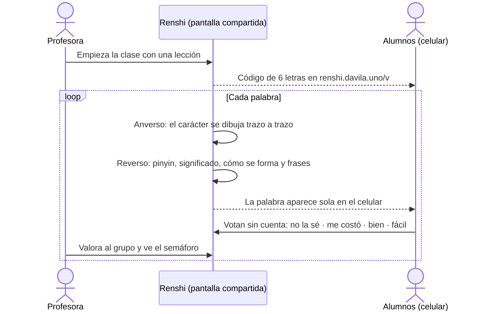

<div align="center">

# 认识 · Renshi

**rènshi** — *conocer, reconocer*

Vocabulario chino **en contexto**, hecho para enseñar en clase por videollamada.

**[renshi.davila.uno](https://renshi.davila.uno)**


</div>

---

## 🀄 El problema

Las tarjetas de vocabulario de siempre muestran palabras sueltas:
`认识 → conocer`. Así no se distinguen sinónimos aparentes (房子 / 家), no se
ven los distintos usos de una palabra (家 también es clasificador: 一家公司) y
partículas como 了 o 过 son imposibles de entender.

Renshi enseña cada palabra **dentro de frases**, con lo que el chino necesita y
una tarjeta normal no tiene: el orden de los trazos, de qué piezas está hecho
cada carácter y cómo se usa de verdad.

## 🎴 Cómo es una clase



## ✨ Lo que hace hoy

**La tarjeta**
- Anverso con la **animación del orden de trazos** sobre la cuadrícula 米字格.
- Reverso con pinyin, significado y **cómo se forma**: 知 zhī = 矢 shǐ + 口 kǒu,
  con el radical en verde y la parte fonética en azul.
- **Frases de ejemplo** con la palabra resaltada, pinyin y traducción a demanda,
  y audio.
- Si una palabra todavía no tiene frases, la tarjeta propone *"Inventen una
  frase con…"*: usarla enseña más que reconocerla.

**La profesora**
- Colecciones y lecciones propias, o copiadas de plantillas HSK en un clic.
- Busca en todo el catálogo por hanzi, pinyin sin tonos (`pengyou`) o
  significado, o pega la lista de palabras de su libro.
- Escribe sus **frases propias** (privadas) o hace su versión de una frase de la
  base. Si se la sugiere al admin y la acepta, pasa a la base de todos.
- Elige cuántas frases salen por palabra; cada clase **rota** y muestra
  primero las que ese grupo aún no vio.

**Los alumnos**
- Votan desde el celular **sin cuenta y de forma anónima**, con un código de
  seis casillas.
- La votación **sigue a la clase**: cuando la profesora pasa de palabra, el
  celular cambia solo.

**El contenido**
- Las **10 896 palabras de HSK 3.0** (niveles 1–6 y la banda avanzada 7–9),
  con significado en español.
- Unas 2650 frases curadas para HSK 1–3, más trazos y descomposición para los
  caracteres de todos los niveles.
- El admin cura la base común; las docentes nunca la editan directamente.

## 🧭 Lo que viene

Para no prometer lo que no existe, esto **todavía no está**:

- [ ] Frases de ejemplo para HSK 4–9 (hoy salen con la consigna).
- [ ] Palabras propias de la docente, para lo que no está en el temario (拜拜).
- [ ] Práctica de escritura: calcar o de memoria, con la tolerancia ajustable
      por nivel (en prueba).
- [ ] Plantillas por tema: comer fuera, viajes, trabajo… (en la base de
      desarrollo).
- [ ] Probar la votación con una clase real y muchos celulares a la vez.

## 🛠️ Stack

| | |
|---|---|
| App | Next.js 16 (Cache Components) · React 19 · TypeScript |
| Interfaz | Tailwind v4 · shadcn/ui · next-intl (中文 / español / English) · next-themes |
| Datos y login | Supabase: Postgres con RLS en cada tabla; los alumnos votan por dos funciones públicas, sin clave secreta en el servidor |
| Despliegue | Vercel en São Paulo (`gru1`), junto a la base |
| Chino | Hanzi Writer · Make Me a Hanzi · temario oficial HSK 3.0 |

## 🚀 Correrlo en local

```bash
npm ci
cp .env.example .env.local   # y rellenarlo con los datos de Supabase
npm run dev                  # http://localhost:3000
```

Sin cuenta se puede abrir la lección de demo en `/present`. Para todo lo demás
hace falta una base de Supabase con las migraciones de `supabase/migrations`
(`npm run db:migrate`).

**Base de desarrollo.** Toda migración se prueba primero en una base aparte
(`hanzi-dev`), nunca directo en producción:

```bash
npm run dev:base-dev         # servidor contra la base de desarrollo, puerto 3001
```

**Pruebas**

| Comando | Qué comprueba |
|---|---|
| `npm run test:unit` | Rotación de frases, semáforo y categorías |
| `npm run test:db` | Migraciones y permisos (RLS) en una base local con PGlite |
| `npm run test:visual` | La tarjeta en 4 tamaños de pantalla, claro y oscuro, con contraste y foco de teclado |
| `npm run test:recorridos:dev` | Recorridos con sesión real: docente, alumno anónimo y admin |

Las sesiones para los recorridos se guardan con `npm run test:sesion:dev admin`
(y `laoshi`): abre el login y la contraseña la escribe una persona, nunca un
script.

## 📚 Datos y licencias

| Datos | Fuente | Licencia |
|---|---|---|
| Temario y niveles | HSK 3.0 oficial (2025/2026) | lista oficial |
| Glosas en español | [Gushi](https://gushichinese.com/es/hsk-3.0/downloads) | CC BY-SA 4.0 |
| Descomposición de caracteres | [Make Me a Hanzi](https://github.com/skishore/makemeahanzi) | LGPL v3 o posterior |
| Trazos | [hanzi-writer-data](https://github.com/chanind/hanzi-writer-data) | Arphic Public License |

El detalle por archivo está en [data/README.md](data/README.md) y la política
editorial en [contenido/POLITICA-DE-CONTENIDO.md](contenido/POLITICA-DE-CONTENIDO.md).

## 🗂️ Documentación

| Archivo | Contenido |
|---|---|
| [IDEA.md](IDEA.md) | De dónde salió la idea, argumentos y referencias |
| [ARQUITECTURA.md](ARQUITECTURA.md) | Modelo de datos, pantallas y fases |
| [AGENTS.md](AGENTS.md) | Estado actual, reglas y decisiones (fuente de verdad para los agentes de IA) |
| [BITACORA.md](BITACORA.md) | Registro técnico día a día: qué cambió, por qué y qué quedó sin probar |
| [IDEAS-POR-CONTRASTAR.md](IDEAS-POR-CONTRASTAR.md) | Ideas y hallazgos todavía sin decidir |
| [DIAGNOSTICO-MODO-CLASE.md](DIAGNOSTICO-MODO-CLASE.md) | Diagnóstico del modo clase, evaluación grupal y votación anónima |
| [BRIEF-DISENO.md](BRIEF-DISENO.md) | Brief del diseño visual |
| [LECCIONES.md](LECCIONES.md) | Lecciones técnicas heredadas de otros proyectos |

---

<div align="center">

Hecho por [Ever Dávila](https://davila.uno) para su clase de chino,
con Claude Code, Codex y Cline como compañeros de trabajo.

*认识一个字，不如认识一句话。* · Mejor conocer una frase que un carácter.

</div>
